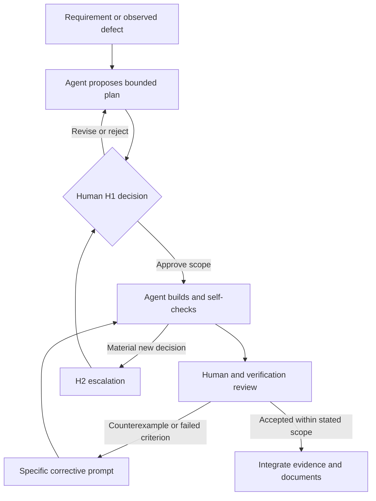
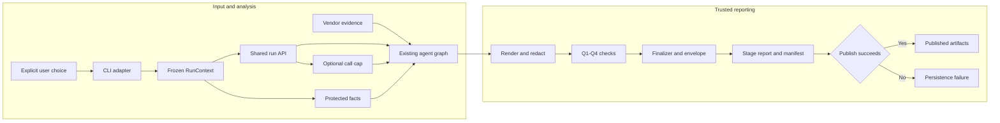
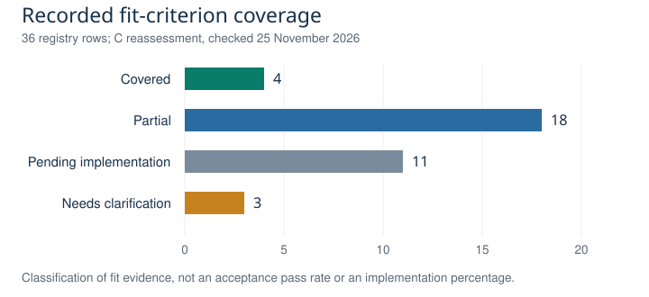
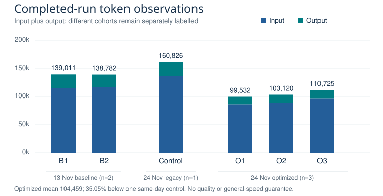
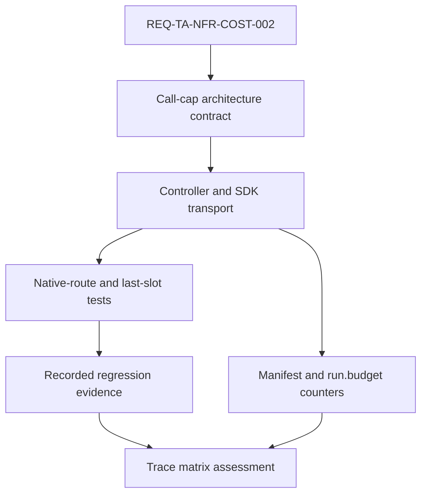

# Engineering an Auditable Multi-Agent Research System

## CS5351 Project Summary Report

**Team members:** ZUO Qian (61048550), Leung Kwan Kit (57611829), Liu Shuhui (60469881), Seilkhanova Aiaru (61017260), and Hu Yifeng (60889168).

**Date:** 25 November 2026. The main report follows the supplied cross-project synthesis and its pinned source/evidence references. The original synthesis was prepared by Member B; the team information and five individual reflections have been integrated for the final report. Historical measurements remain tied to their recorded configurations and revisions.

| Role | Student name | Student number | Contribution | Relative weight |
|---|---|---|---|---|
| A | ZUO Qian | 61048550 | 18% | 0.90 |
| B | Leung Kwan Kit | 57611829 | 23% | 1.15 |
| C | Liu Shuhui | 60469881 | 18% | 0.90 |
| D | Seilkhanova Aiaru | 61017260 | 18% | 0.90 |
| E | Hu Yifeng | 60889168 | 23% | 1.15 |

The percentages are the team-confirmed contribution allocation. Relative weights use the course's mean-one convention: each percentage is divided by 20%, giving weights that sum to 5.00. They are not invented productive-hour measurements.

## Executive summary

We extended a TradingAgents codebase labelled version 0.7.1 into a more auditable research application. The existing system already supplied an AI agent graph, tools, memory and basic portfolio loading. Our contribution was to strengthen how inputs are selected and confirmed, how portfolio facts reach decision stages, how trusted application records remain separate from model advice, how failures are published, and how evaluation evidence is checked. We also implemented an optional run-wide model-request cap and a reversible reduction in repeated intermediate context. These changes preserve the research workflow rather than replace the baseline. [S01] [S02]

The process combined machine-readable requirements, architecture alternatives, bounded coding prompts, human plan approval, agent implementation, negative testing and revision from evidence. A key finding was that a plausible report, a passing local check and trustworthy evaluation evidence are different achievements. An empty-portfolio narrative could assume ownership despite a deterministic pass; a final correction could leave wrong intermediate advice visible; a reported success could conflict with failed persistence. These failures motivated explicit authority and evidence boundaries. [S03] [S04]

At the source inspected for the supplied report, the offline suite passed 1,976 tests, with two skips, one deselection and 100 passed subtests. Type, lint, schema and selected security checks passed. Historical optimization runs averaged 104,459 tokens for one NVDA profile, 35.05% below one same-day control. These are useful scoped results, not proof of universal financial correctness or a hard token ceiling. The broader 36-entry registry remains proposed, formal semantic acceptance remains pending, and two required course gate categories are not fully enforced. Our report makes these limits inspectable rather than hiding them behind aggregate test counts. [S05] [S06] [S07]

## 1. Purpose, baseline and contribution boundary

### 1.1 The engineering problem

TradingAgents uses specialized analysts, a research debate, a trader, a risk discussion and a final portfolio-management decision to generate stock research. Its value depends on composing uncertain model outputs with external evidence. That composition also creates failure opportunities: a later agent may inherit an unsupported assumption, tool failure may look like absence of evidence, and a convincing final recommendation may conceal contradictory intermediate sections. Our aim was to improve the software controls around that workflow, while retaining a usable single-instrument research application.

The intended user can explore research without supplying a portfolio or can provide a selected holdings snapshot. Neither mode connects to a brokerage account or authorizes an order. A portfolio is user-supplied context, not verified account truth. The program must therefore distinguish research ratings from trade actions and must not turn missing account information into a fabricated position or cash balance. Product usefulness and auditability were joint design goals: requiring every visitor to upload holdings would remove the original exploration path without addressing the underlying reasoning defect.

### 1.2 What the team added

Source history matters when attributing the work. `portfolio.py` predates the team's `runapi` implementation, so basic portfolio ingestion is not presented as our invention. The team added a discover/select/confirm workflow, an immutable run context, safe provenance, deterministic result checks, isolated publication and stronger context propagation. Later work added evidence-integrity repairs, evaluation-population binding, leading disclaimers, an opt-in request cap, concise context assembly and executable governance tooling. The project version string alone does not identify which of these changes a measurement exercised. [S02] [S08]

The course clarification permits extending a baseline but counts only the team's agent-generated components as the contribution. We accordingly distinguish inherited capabilities, team implementation and proposed extensions throughout. We do not count the entire inherited agent graph as new work. We also avoid equating a document describing a desired mechanism with code that implements it: evidence identifiers, complete channel coverage, sentiment correction and cumulative token/time admission remain substantial design or acceptance gaps.

### 1.3 Success criteria

We assess progress through observable contracts: explicit input choice, stable provenance after source changes, truthful completion/failure records, check authority outside model prose, safe publication under injected failure, and evaluation records bound to their actual cases and configuration. Efficiency changes additionally require comparable measurements and quality review. These criteria make the project assessable without requiring a stochastic model to produce the same rating on every run. Financial suitability and profitable trading are outside the demonstrated software guarantees.

## 2. Team process and supervised development

### 2.1 Responsibilities and practical rotation

The initial split allocated requirements to A, architecture to B, verification to C, measurement work to D and integration/governance to E. Actual contributions crossed those boundaries: B performed integration reviews and directed bounded repairs; C contributed result/report repairs; E implemented context and budget mechanisms. The final attribution should reflect delivered work rather than assume every file under a nominal role was written exclusively by that person. Commit authorship also does not establish manual code authorship when implementation was agent-generated. [S09] [S10]

The team agreed contribution percentages of 18%, 23%, 18%, 18% and 23% for A through E. Under the course's mean-one convention, the corresponding weights are 0.90, 1.15, 0.90, 0.90 and 1.15. These sum to five. The allocation is a team decision rather than an estimate reconstructed from commit counts; no precise productive-hour record is inferred.

### 2.2 Iterative sequence

| Period | Main activity | Evidence and resulting change |
|---|---|---|
| Initial architecture work | Select a feasible working scope and compare C1/C2/C3 | C2 selected after constraint screening, weighted comparison and corrections |
| 18 November review | Exercise the integrated product and live portfolio cases | Empty-portfolio ownership defect recorded; failures retained |
| 20–21 November | Reconcile broader requirements and repair R1–R5 | Proposal remains distinct from adoption; approval precedes bounded implementation |
| 21 November live follow-up | Inspect all delivered decision stages | Trader arithmetic and Fundamentals vintage repairs; numeric extension left proposed |
| 24–25 November | Integrate context optimization, request cap, H3/H5 and governance | Contracts updated from merged code, tests and retained evidence |
| Submission preparation | Reassess fit coverage and assemble transcripts | Partial coverage remains explicit; complete captured session boundaries preserved |

This was an iterative history, not a clean waterfall reconstructed after the event. The later requirements reconciliation followed an earlier selected-scope architecture. Changes required checking both directions: whether implementation matched the design and whether the design still described newly merged implementation. We preserved historical decisions and added dated status corrections rather than replacing past failures with a success narrative. [S11]

### 2.3 Human checkpoints

The static launch prompt defines planning, approval, bounded build, self-verification and human review. H1 approves a concrete plan; H2 escalates material scope or contract changes; H3 reviews the outcome. An instruction to plan is not permission to build, and a short “continue” resumes existing scope rather than granting unrestricted authority. These process decisions are recorded in conversations; their existence in a prompt does not mean the launcher authenticates or automatically enforces them. [S12]

*Figure 1. The supervised development loop. The diagram describes the process; it is not evidence that every checkpoint is an automatic merge gate.*

## 3. Requirements engineering and scope control

### 3.1 Three different requirement states

The working selection contains 19 `SEL-TA-*` identifiers: seven functional, six non-functional and six governance entries. It made early architecture and testing manageable. The broader machine-readable registry has 36 active entries and three withdrawn identifiers, including 23 Must, 11 Should and two Could priorities. Its recorded statuses are 26 proposed and ten partial; document status remains `proposed_for_adoption`. These labels express registry state, not the outcome of running the software. [S13] [S14]

The course obligations form another layer. Passing the selected requirements does not imply that the full registry or every D1–D9 obligation is satisfied. We therefore map `SEL-TA-*`, `REQ-TA-*` and architecture `INV-*` identifiers by meaning, not by their numeric suffix. This distinction prevented several misleading mappings, including assigning an existing CI check to a different governance obligation simply because its number looked similar.

### 3.2 Definitions with implementation consequences

Research ratings are Buy, Overweight, Hold, Underweight and Sell. The Trader's actions are Buy, Hold and Sell. `REVIEW` is a system-facing fallback for unreadable output, not another research opinion. `BUDGET` is a stop reason, not a rating. These distinctions affect result validation, user presentation and test oracles; vocabulary mistakes cannot be fixed by making labels merely look consistent.

Absent portfolio data means holdings and cash are unknown. An explicitly empty supplied portfolio is known flat input. A supplied holding with missing cash does not imply zero cash. In the exploration path, Hold means the evidence does not support a new directional action; it must not imply “retain your existing shares.” This requirement motivated protected context at multiple decision stages, while leaving legitimate conditional discussion distinguishable from a claim of actual ownership.

Similarly, “unavailable” data is not proof that no event or position exists. Source dates, fiscal periods and analysis cutoffs affect what a report can claim. Existing date guards provide useful protection, but they do not establish a complete evidence registry or all required freshness/coverage boundaries. Treating a failed run as an automatic source-reliability grade would conflate execution status with the quality of evidence already obtained. [S14] [S15]

### 3.3 Machine checks and their limits

A's package separates schema structure, cross-record validation and negative fixtures. The current validator reports 36 requirements, three withdrawals, zero errors and zero warnings. All 32 negative fixtures fail for their intended reasons. Tests require an appropriate finding rather than accepting any non-zero exit: a traceback is not proof that a specific semantic rule works. This is a concrete example of testing the checker rather than treating it as an oracle by construction. [S16]

The package still cannot decide whether an otherwise valid requirement is the right product choice, whether its parameter is adopted, or whether code meets it. Review found phantom references, scope conflicts and checker blind spots despite apparently successful validation. Requirement generation and requirement acceptance remain separate activities. The registry is useful precisely because it exposes unresolved ownership and parameters rather than silently treating them as complete.

### 3.4 Volatility and ambiguity

The project moved from a selected implementation scope to a broader proposed registry while preserving withdrawal and source notes. The counts 19 and 36 are not a measured percentage of requirement growth: their namespaces and governance coverage differ. We have not built a normalized change-per-sprint volatility metric. What we can demonstrate is a versioned change trail and recurring ambiguity classes: scope versus fixture conflict, rating/action confusion, unclear failure terminology and acceptance population versus attempt counts. A future project should assign baseline dates and change reasons before using volatility statistics as process evidence.

## 4. Architecture decision and resulting structure

### 4.1 Candidate evaluation

We compared three alternatives. C1 minimally extended the CLI and kept much lifecycle sequencing inline. C2 introduced an input service, immutable `RunContext` and a small lifecycle coordinator with independent checking and finalization seams. C3 added a broader phased orchestrator façade. All passed ten disqualifying constraints, including no prompts in agents, no silent file choice, explicit absent/empty semantics, independent check authority and no resume expansion. [S17]

| Candidate | Main tradeoff | Baseline estimated score |
|---|---|---:|
| C1 | Smaller initial change, but more scattered lifecycle/provenance discipline | 3.300 |
| C2 | Clear test seams and shared provenance at moderate change surface | 4.650 |
| C3 | Strong central orchestration with broader implementation disruption | 3.750 |

The six criteria were testability, change surface, auditability, failure behavior, compatibility and estimated effort. Two sensitivity scenarios retained C2's ranking: 4.525 under change-surface emphasis and 4.800 under testability emphasis. These are design estimates, not benchmark results or statistically validated superiority. C2 was selected because it provided an explicit input boundary and shared provenance without C3's wider orchestration change. The original comparison is preserved rather than retrospectively rescored to justify the implemented system.

### 4.2 Current component boundaries

The dependency direction is CLI to shared run API to graph/agents/dataflows. The CLI owns interaction; the shared API performs prompt-free mandatory checks, execution, exception mapping and publication. Agents receive context but do not open terminal prompts. The checker does not contact a model. The persistence layer owns publication rather than asking the model to describe whether saving succeeded. This separation gives verification independent places to inject failures and inspect outcomes. [S01] [S08]

*Figure 2. Main application boundaries. This is a structural overview; the budget-counter appendix currently added after checking is a recorded deviation discussed in Section 6.*

### 4.3 Design evolution without invented experiments

Later ADRs describe extended evidence/checker contracts, concise context and proposed cumulative token admission. They document additional alternatives and decisions, but we do not label every documentation correction as a newly executed ADD experiment. The call-count slice was implemented; the richer token ledger was not. Several extended contracts still need adopted parameter values, provider-bound evidence and accepted scenarios. A proposed design can support the next implementer without establishing that the current program already enforces it. [S18]

## 5. Input identity, consent and protected facts

The input service discovers candidate files and supports explicit selection rather than silently picking the first file. Validation distinguishes invalid input, absence and a supplied empty snapshot. The user confirms the chosen mode before analysis proceeds. The shared API rejects an unconfirmed context, so confirmation is not only a visual CLI convention. The registry still lacks a dedicated active requirement owning every confirmation/decline/EOF transition; implemented behavior and requirements coverage are therefore reported separately. [S08] [S14]

Once selected, normalized portfolio content is frozen. A full SHA-256 fingerprint describes normalized content, not merely the filename or a shortened display token. Basename, as-of value and its basis accompany the identity. A later source-file overwrite must not change the confirmed run or its published provenance. Tests also attempt consumer mutation and distinguish a new selection from the old frozen identity. A fingerprint is an integrity/provenance mechanism, not proof that a user-supplied holding is true or that the input is encrypted.

Protected portfolio context reaches Research Manager, Trader and Portfolio Manager. This addresses a concrete failure in which upstream reasoning invented exposure even when downstream text corrected it. Each decision stage receives the same authoritative supplied facts and instructions to correct inconsistent upstream assumptions. Deterministic delivery is enforceable; narrative obedience remains a semantic property. We therefore avoid the stronger, unsupported claim that protected context makes a model unable to assert a nonexistent position. [S03] [S19]

This distinction also informs privacy. Safe metadata projections may be persisted for audit; raw holdings, prompts and provider payloads should not flow automatically into every sink. Redaction covers diagnostic and publication boundaries, and tests plant credentials to check selected sinks. The full all-vendor/all-output matrix remains incomplete, so the report describes scoped privacy safeguards rather than universal non-disclosure.

## 6. Results, checker authority and publication

### 6.1 Result consistency

`COMPLETED` means the workflow reached a completed result; it does not mean it passed semantic evaluation. A completed report can be `NEEDS_REVIEW`. An incomplete run has no final rating and its output check is `NOT_RUN`. Stop reasons include DATA_UNAVAILABLE, MODEL_FAILURE, INTERRUPTED, PERSISTENCE_ERROR, INTERNAL_ERROR and BUDGET. Corrected-only findings can coexist with PASSED; any blocking finding requires NEEDS_REVIEW. Public result validation rejects inconsistent combinations such as REVIEW/PASSED. [S20]

| Mechanism | What it establishes | What it does not establish |
|---|---|---|
| Q1 rating check | Allowed final research label or visible review outcome | Correct investment judgment |
| Q2 provenance check | Fragment agrees with trusted frozen metadata | External evidence itself is true |
| Q3 disclaimer presence | Required notice exists in checked body | Every export position or safety statement is compliant |
| Q4 prohibited phrases | Selected guarantee wording is detected | Full prompt-injection or financial-safety resistance |

The model cannot overwrite these checks by saying its report “passed.” Q1–Q4 are the current implementation. The broader R1–R8 evidence, ownership, sentiment and coverage rules are not fully implemented; supported finding types do not constitute implemented correction algorithms.

### 6.2 Leading notice and compatibility

Trusted rendering places the frozen disclaimer before title and provenance in complete Markdown. HTML places it first in visible body content even with missing/empty metadata; structural document markup is excluded from “first visible.” The existing body footer is retained. This is one frozen wording in two permitted locations, not a model-generated substitute. Positive layout tests and a negative “present but only later” test distinguish first-position compliance from a weak contains-only test. Per-agent section files are not automatically standalone complete reports. [S21]

### 6.3 Truthful publication

We stage the report and manifest in a run-isolated location and publish them through a directory commit point. A critical failure returns PERSISTENCE_ERROR rather than leaving a misleading completed outcome. Terminal-event append is best-effort; a failure there is not automatically a failed critical publication. Event durability is reported honestly. These policies keep returned status, saved records and event visibility consistent within the tested local-filesystem protocol; they are not a claim of distributed transactions or power-loss durability on every storage system. [S22]

Review and failure injection were important because an early implementation could expose success before a later save failure or produce contradictory terminal messages. The repair required checking chronology, not just testing that individual functions returned expected values. A downstream bookkeeping exception must not manufacture failure after successful publication while saved records still say completed.

One current deviation remains: enabled call-budget text is appended after the body checker runs. Although the appended fields are trusted counters, this does not satisfy the architecture's strict “checked bytes equal delivered bytes” claim without qualification. We record it as an unresolved integration decision: move the appendix before checking or explicitly adopt a separately specified envelope scope. We do not silently weaken the invariant or describe exact-byte coverage as fully implemented. [S08] [S01]

## 7. Context handling and cost controls

### 7.1 Concise intermediate context

The optimization preserves agent roles and tools while changing intermediate writing and repeated-context assembly. Analysts receive an advisory target around 450 words; researchers/risk debaters around 220. Evidence dates, units, fiscal periods, contradictions and missing-data disclosures take priority. These are prompt targets, not hard truncation or output-token guarantees. Shorter reports reduce both their generation cost and the input repeatedly read downstream. [S06]

When an exact opponent argument already exists in history, a separate copy can become a reference. This uses Python string-substring matching, not semantic deduplication. A compaction safeguard restores explicit content when the original assembly would exceed the guard threshold. Review nevertheless found a boundary counterexample: a 76,799-character original was within a 76,800 threshold, while its reference form grew to 76,875. Checking only original length could miss compaction of the reference form. An unconditional no-dangling-reference guarantee is therefore not established. The proposed fixes and a real-guard regression remain follow-up work. [S23]

The configuration switch `concise_intermediate_reports` supports rollback and is recorded in effective configuration. Prompt hashing fingerprints selected source text and frozen strings; it is not an extractor of only the active prompt variant. Source changes can change the hash even when concise mode is disabled. A missing/unreadable source can also be skipped by the current hash builder, so relying on that hash as a formal gate needs a defined preflight policy. Configuration evidence and hashing have complementary scopes.

### 7.2 Implemented request admission

The optional call cap enforces `dispatch_attempts <= successful_reservations <= CALL_CAP` for its supported synchronous client profile. Both model tiers, bound tools, structured retries/fallbacks and in-run reflection share one run controller. A reservation is single-use; denial dispatches nothing; issued failed attempts consume capacity; invalidating an unsent grant does not refund it. A race for the last slot is tested atomically rather than inferred from sequential examples. [S24]

Enforcement sits at the SDK-native HTTP transport family, selected dynamically for httpx/httpx2. SDK/transport retries are disabled for the bounded profile; an application retry needs a new reservation. Async and unsupported provider/client routes are rejected. Gateway-internal retries and arbitrary custom integrations outside the controlled factory are outside this client-side guarantee. Finishing exactly at the cap is normal completion; refusing a required next call produces INCOMPLETE/BUDGET/NOT_RUN with no rating.

Disabled runs preserve legacy manifest schema `"1"`. Enabled records use schema version 2, check-rule version 1 and explicit cap/granted/dispatched/invalidated/denied counters. Readers reject unknown or inconsistent combinations. The default cap remains disabled; eight is a test/example value, not an adopted universal production setting. These details matter because an opt-in mechanism is not an always-on product ceiling.

### 7.3 What remains proposed

A call-count bound is not a cumulative token or elapsed-time bound. The proposed token controller reserves input plus permitted output, settles known usage and retains unknown consumption; unsupported profiles require defensible bounds rather than invented estimates. That design is not implemented. Similarly, observed short runtimes do not prove cancellation of an in-flight call within a fixed allowance. Calibrating a reference budget, measuring optimization and detecting regressions are three distinct tasks. [S18] [S14]

## 8. Verification method and current results

### 8.1 Three levels of evidence

Structural checks cover layering, public API compatibility, schema and selected permissions/security boundaries. Regression tests exercise prior behavior with synthetic engines, controlled vendor responses and failure injection. Behavioral evaluation inspects live research, ownership, dates, injection handling and other semantic properties. A pass at one level does not replace the others. The standard pytest configuration excludes integration tests, and paid live replay is opt-in. [S25]

Negative tests were particularly valuable. They attempted consumer mutation after input freeze, conflicting replay mirrors, forged metadata in report bodies, reuse of reservations and competing dispatches, invalid rating/finding combinations and late-only disclaimers. Several appeared correct under ordinary positive examples but failed these probes. The lesson is to test authority boundaries and lifecycle ordering, not only successful helper calls.

### 8.2 Verification at the inspected source

| Check at inspected source | Observed result | Scope |
|---|---|---|
| `python -m pytest -q` | 1,976 passed; 2 skipped; 1 deselected; 100 subtests passed | 47.55 seconds; 24 warnings; offline default profile |
| mypy using `pyproject.toml` | No issues in 15 source files | Incremental shared-boundary/type-contract scope |
| Ruff | All checks passed | Configured repository lint rules |
| `pip check` | No broken requirements | Installed dependency consistency, not a fresh vulnerability audit |
| Requirements validator | 36 entries; 3 withdrawn; 0 errors/warnings | Structural/cross-record validity, not adoption |
| Negative-fixture harness | 32 expected failures | Intended rule failure, not an unrelated crash |
| Workflow permission check | Passed for 5 workflow files | Token/workflow boundaries |
| Security scan | 107 application Python files; no medium/high findings | Configured Bandit scope and reviewed suppressions |

The skips were the opt-in semantic replay and unavailable optional `langchain_aws`; the deselection follows the integration exclusion. Warnings concern model-catalog compatibility in synthetic tests. None is silently counted as a pass. These are fresh supervising-review executions, not results newly produced by the historical OpenCode sessions. The evidence sidecar records commands and source bindings. [S05]

Earlier reports contain 1,797, 1,918, 1,954 and 1,974-pass suites at different revisions/environments. We retain their history rather than add them together or present all as current-source results. Larger test counts are not, by themselves, evidence of higher quality: suite membership, optional dependencies and the assertions exercised must also be understood.

### 8.3 Fit-criterion reassessment

C's current 36-row mapping classifies four entries covered, 18 partial, 11 pending implementation and three needing clarification. This is a scoped assessment of recorded fit criteria, separate from A's 26-proposed/ten-partial registry statuses. The four covered entries are call admission, unreadable-rating consistency, frozen input identity and the requirements-schema gate. Covered does not mean universal live acceptance. [S15]

*Figure 3. Classification of the 36 current mapping rows. This is not a test pass rate or a percentage of the application implemented. Recomputed from C's mapping for this report.*

## 9. Live findings and evaluation integrity

### 9.1 Evidence-led repairs

The 18 November diagnostic retained five completed cases plus an operator-interrupted start. An empty supplied portfolio still produced ownership-assuming advice despite deterministic PASSED. Later live work inspected Research Manager, Trader and Portfolio Manager rather than only the final label. It found Trader arithmetic presenting 258.47 minus 255.33 as 6.6 points; the actual difference is 3.14. A separately approved L1 plan constrained the repair. L2 addressed a Fundamentals summary claiming a later reporting period while its own caveat said that income statement was unavailable. [S03] [S04]

These fixes are bounded prompt repairs, not a universal financial arithmetic or temporal-reasoning validator. Later reports still contained numerical limitations, so a numeric-validation extension was drafted but not implemented. We preserve those limitations and the distinct approval records rather than claiming that subsequent clean examples proved all generated calculations correct.

### 9.2 Fresh evidence cannot repair missing historical evidence

The 21 November package retained 15 completed starts across a selected ten-attempt cohort and five earlier/outside-cohort attempts. The selected cohort has five semantic cases, two trials each; six selected reports were PASSED and four adversarial reports NEEDS_REVIEW under Q1–Q4. The all-start population had six review-needed reports. These different denominators must not be interchanged. [S26]

Without accepted human scores the packaged scorer returned PENDING. An AI-proposed score sheet could mechanically produce PASS, but `human_approved` remained false, and the genuine score file retained null cells. That is plumbing evidence, not formal acceptance. The old F8 PASS remains unverified because its original evidence was unavailable. New evidence shows what a new captured source did; it cannot authenticate a different historical claim. [S07] [S26]

### 9.3 Binding cases, attempts and populations

H3 now exposes distinct-case and population-result counts through `summarize_records(records, *, population=None)`. `EvaluationPopulation` declares population identity, source revision, prompt hash, configuration fingerprint and expected case IDs. Records must match declared controls; duplicate attempts, invalid cases and inconsistent bindings are rejected. Unresolved starts stay in the completion denominator. Missing population controls yield unknown population count, not a fabricated validated aggregate. [S27]

A 20-case/40-attempt fixture tests arithmetic and binding. It is not a 20-case live quality study. The existing formal-profile runner still uses five cases/ten planned attempts; repeating a case does not increase distinct-case population. The general repeatability/controlled-change comparison reporter is not fully implemented, and the helper refuses unsupported bound comparisons rather than pretending they are valid. Acceptance needs an agreed rubric, critical items, profile and thresholds in addition to counting. The existing five-case policy specifies at least nine eligible completed attempts, at least one completed report per case, completion and semantic scores of at least 90%, and zero critical violations. Those legacy-profile thresholds do not adopt the registry's wider provisional population or settle its open quality parameter.

The hardened evidence path compares reports/manifests with trusted fixture expectations, detects counterfeit metadata outside the authoritative header, validates cohorts and accounts for durable starts before dispatch. This prevents a collection of mutually consistent but wrong-case files from passing merely because they agree with each other. Declared metadata is still not a digital signature or a defense against every deliberately malicious caller.

## 10. Efficiency results and experimental interpretation

### 10.1 Historical measurements

D measured two baseline NVDA runs at `2c22ef9`: 139,011 and 138,782 total tokens. Three later runs at `98b82c9` used 153,439, 154,514 and 137,223. Their means are 138,896.5 and 148,392: a 6.84% increase in the later historical cohort. This is not evidence that the subsequent concise-context optimization failed; that optimization was not the experimental factor in this earlier comparison. Mean latency was approximately 114 seconds in both cohorts. [S10]

D also found that the CLI panel and graph usage instrumentation disagreed. Reporting from the computation rather than the display avoided a misleading cost estimate. One attribution run showed repeated context growing across analyst tool rounds. Its stage percentages identify likely targets but are not stable population estimates. The observation of increasing history does not establish an asymptotic complexity bound for the entire system.

### 10.2 Concise-context study

The later same-day legacy control used 160,826 tokens; three optimized runs used 99,532, 103,120 and 110,725. Their exact mean is 104,459. The relative reduction is 35.05% against that one same-day control and 24.79% against the earlier two-run mean. The optimized times were 69.51, 69.84 and 68.45 seconds, compared with 132.71 seconds for the control. These are observations under one NVDA/date/profile, not performance guarantees. [S06] [S36]

*Figure 4. Completed-run token totals reconstructed from retained records. Historical baseline and same-day control are different cohorts. Error bars/confidence intervals are intentionally absent because these samples do not justify a general performance estimate.*

The closer comparison held analysts, debate rounds, model tiers and memory isolation fixed while toggling the context behavior. It used provider-reported input plus output usage and the `openai_compatible` wrapper. The earlier baseline used a differently labelled provider, so its comparison is descriptive. Model-selected lookback windows also differed. Raw graph benchmarking is not equivalent to acceptance through the supported `run_analysis_api` boundary.

The initial missing-price comparison and a rate-limited attempt with 8,299 partial tokens were excluded from successful reduction averages and explicitly recorded. They are not treated as completed low-cost runs. Cached-price diagnostics form another separate profile. All three optimized online runs had real price rows ending on the analysis date and agreed with an adjusted-price verification snapshot; that does not certify every news, sentiment or financial claim in the report.

### 10.3 What the experiment supports

The results support pursuing shorter repeated intermediate context for this measured configuration. They do not isolate brevity from duplicate-reference effects because no ablation was performed. There is one same-day control, no broad ticker/portfolio population and no independent semantic acceptance. We consequently avoid claiming statistical significance, universal 35% savings, a hard 120,000-token budget or general speedup. Cost calibration should next use the supported entry point, representative repeats and quality/completion criteria before selecting a margin.

## 11. Traceability as an executable review aid

The canonical E-owned matrix links requirements to B's decisions/contracts, source components, tests and observations. B supplies allocations and corrections; C owns independent verification; A owns meanings/adoption; D supplies implementation/measurement evidence; E assembles the delivery view. A link to a file proves existence, not completeness of its assertions. [S28]

For example, `REQ-TA-NFR-COST-002` links to the call-budget contract, controller and transport, developer concurrency/native-routing tests, and manifest/event counters. The last-slot fixture sets cap eight with seven consumed and four competing workers: one gets a grant and three are denied. It tests the admission invariant, not an inference from low observed usage. The runtime evidence distinguishes successful exact-cap completion from refusal of a required next request.

*Figure 5. A requirement-to-evidence chain. The chain concerns request admission; it does not establish token, time or semantic-quality bounds.*

Traceability review also corrected proposed monitor labels that were not emitted events. `input.selection`, `output.provenance`, `security.redaction` and `api.entry` must not be presented as an event inventory. Some are code/artifact observations; others remain proposed labels. Actual events such as `run.started`, `output.check`, `run.budget` and `run.terminal` are conditional. Static source inventory is not evidence that every event occurred in every run.

## 12. Coding-agent governance and course gate status

### 12.1 Controls actually present

The repository has root agent guidance, a covenant, static launch prompt, structural/verification constraints, permission configuration and CI tools. Seven required-status names were recorded by E: required tests, Ruff, dependency check, AI-log updated, requirements schema, type check and security checks. The workflow files and fresh local checks support their implemented scope; E's dated administrative observation is not a live settings inspection performed for this report. [S29] [S28]

Course gate categories cannot be counted by counting GitHub job names. In particular, test-plan pre-approval is paused as a required merge check, and no required semantic-replay gate currently evaluates every governed prompt/model change. The proposed technical semantic-gate contract specifies trigger paths, source/configuration binding, trusted grading revisions, score packaging and PASS/FAIL/PENDING. Documenting that interface does not install it. These are material course-compliance gaps, not optional cosmetic improvements. [S30]

| Course gate category | Current evidenced position |
|---|---|
| Approval before implementation | Historical approvals retained; automatic required pre-approval gate paused |
| Static analysis/safety checks | Implemented, with incremental type/security scope |
| Requirements schema | Implemented; cross-record and negative checks exercised |
| Semantic evaluation for prompt/model changes | Runner/scorer exist; required automatic gate absent; formal acceptance pending |
| Regression | Required offline suite present; live/integration exclusions remain explicit |
| AI-use logging | Relevant-path update checker present; log authenticity needs human review |

### 12.2 Conditional local permissions

The native role package is configured for OpenCode V1 1.19.5 and uses last-matching-rule-wins ordering. Explicit launcher/profile activation is required. Retained E evidence records 69 synthetic cases. The known local 1.18.34 executable was refused by the version guard, and the long-running architecture conversation was not demonstrated to be under strict B. Merely having configuration files cannot establish active restrictions in an unrelated session. [S31]

Strict roles limit owned writes and deny bypass channels such as general shell/search/delegation. Administrative Git and external verification require an authorized human/session. The controls are not OS ACLs, authenticated member identities or an immutable audit store; a machine owner can change launch choices. The launcher also cannot automatically authenticate H1/H2/H3 decisions. These limitations are relevant when interpreting demo footage and historical transcript claims.

## 13. Original software-engineering contribution

Mandatory practices such as ADRs, traceability, permissions and regression testing do not become original merely because we used them. Immutable snapshots, hashes and atomic publication are also established techniques. Our defensible contribution is the specific integration of these techniques to address observed multi-agent failure classes, with a stated mechanism, tradeoff and counterexample. We do not claim worldwide novelty or a guaranteed instructor originality verdict.

First, protected portfolio facts cross decision stages rather than being supplied only to the final manager. The motivating defect was a correct-looking final outcome coexisting with unsupported intermediate exposure assumptions. The design gives every decision stage the same input facts and asks it to correct upstream conflict. The benefit is a clearer authority source; the cost is repeated context and continued need for semantic evaluation. We implemented grounding, not a complete portfolio-state metamorphic testing framework.

Second, we separate advisory narrative from authoritative run records and truthful publication. The motivating defect was that visible success could survive save failure or contradict persisted state. The system owns provenance, verdicts and publication ordering outside the model. Failure-injection probes exercise the chronology. The tradeoff is more lifecycle states and compatibility work; the benefit is a falsifiable definition of what was actually published.

Third, evaluation integrity checks use trusted case identity and durable starts, not only consistency between submitted files. A report/manifest pair from the wrong portfolio case must fail, and retrying must not erase unsuccessful starts. Frozen controls and explicit population bindings make this reviewable. More rigorous eligibility increases rejection and evidence-management cost, but it prevents reassuring numbers assembled from ineligible or incomplete attempts.

Concise context is an additional engineering contribution with measured benefit and a discovered boundary defect. The team preserved tool payloads and introduced a reversible configuration rather than adding a summarizer call. The real-guard counterexample also shows why optimization needs semantic-preservation tests. This is a stronger engineering account than presenting “new portfolio input” alone as the original idea. [S19] [S22] [S23] [S26]

## 14. Prompt engineering and authentic supervision

Our implementation prompts specified role, baseline, task, readable/writable paths, exclusions, interfaces, concrete tests, approval boundaries and expected final reporting. Follow-up prompts supplied minimal reproduced failures, identified the violated criterion and limited the repair. Examples include refusing a blanket closure claim after black-box counterexamples and freezing production while a live cohort ran. Precise prompts made review outcomes actionable without permitting unrelated rewrites. [S32]

The project used DeepSeek V4 Flash in OpenCode because that was the school's available model. Supervising Codex work helped inspect artifacts, prepare prompts and perform external verification. These roles must be attributed accurately; a Codex review is not relabelled as an OpenCode build, and coordinator-prepared user prompts are not all claimed as manually authored verbatim by the student. The course's agentic contribution claim needs actual session evidence, not only polished architecture prose.

B's annotated D5 package contains four complete captured OpenCode sessions: 218 original architecture messages, 70 requirements messages, 701 repair messages and 913 later architecture messages. It retains 1,902 native messages, 7,686 parts and 71 marked user-role interventions with retrospective rationales. The earlier 96-entry task-scoped Codex review and three approval/plan records are separately identified. Native tool/write content and source truncation remain visible; 187 privacy-edited string locations are declared. [S33]

This is one student submission containing distinct session identities, not a fictional uninterrupted conversation. Unmodified raw exports remain private; sharing copies are not byte-identical originals where redaction occurred. Other members still need their own D5 evidence, and the team must review collective coverage. The six-message video excerpt is useful presentation material but cannot replace the complete captured transcripts.

## 15. Maintenance, debt and threats to validity

The debt register distinguishes implementation gaps, evaluation debt, governance gaps and integration decisions. Some remaining work is well specified but substantial: evidence IDs/resolution, channel coverage and freshness, expanded ownership/sentiment rules, aggregate token/time admission, comparison reporting and semantic-gate activation. Resume capability inherited from the graph does not establish a complete new checkpoint listing/rerun/identity product contract. [S34]

The strongest threats are small live populations, one same-day optimization control, model/network variability, provider-wrapper differences, local caches, raw-graph versus product entry points and incomplete independent scoring. Hashing binds captured material; it does not certify scientific validity. A manifest can describe a deterministic configuration while generation still varies. A report can contain a disclaimer while making a wrong financial statement. An internally consistent registry can still be unadopted.

Process metrics also need restraint. A's reported three review rounds and fifteen findings illustrate checker/content defects, but they are not a team-wide longitudinal defect-density study. The bug diary records six closeout entries and preserves earlier failures; the F-series, R-series and H-series are different review namespaces, not an additive count of unique bugs. We have no normalized ambiguity-resolution time or coding-agent token-efficiency experiment. We present reproducible examples and source counts rather than manufacture those missing metrics. [S09] [S35]

With more time, we would freeze a smaller adopted delivery baseline earlier, complete independent scoring on that exact source, automate proposed monitor/trace checks and validate concise context through real compaction before expanding optimization claims. New feature development would follow these controls rather than outpace them. The priority is to close known acceptance boundaries before adding another broad design layer.

## 16. Delivery assessment and integration actions

| Deliverable | Existing substance | Remaining integration or acceptance issue |
|---|---|---|
| D1 requirements | Registry, schema, validator, fit criteria and negative fixtures | Adoption and open parameters/owner decisions |
| D2 architecture | Blueprint, ADRs, invariants, context/permission design and trace matrix | Proposed extensions and known checked-byte/reference/hash deviations |
| D3 coding governance | Agent guidance, covenant, tool/permission and structural rules | Conditional activation and safety-review enforcement limits |
| D4 verification governance | Plans, mappings, evidence index, review/debt/bug records | Incomplete fit coverage and independent semantic acceptance |
| D5 transcripts | B complete-capture package; other members' AI records | Assemble five student submissions and check collective pipeline coverage |
| D6 report | Integrated main report, confirmed team allocation and five supplied reflections | Final team submission review |
| D7 repository/gates | Implemented CI, meaningful history and recorded required checks | Paused approval gate; missing required semantic gate; final hosted-state check |
| D8 source/tests | Source under `src/`, tests under `test/offline/` and `test/live/` | Compatibility paths retained; bind final evidence to the delivery revision |
| D9 static prompt | Root `Prompt.md` with plan/build/review sequence | Evidence of actual use remains necessary; not an unattended automation |

For D's integration, use the current registry and code over superseded requirement labels in partial reports. In particular, current COST-002 is the Must request cap; cumulative token admission is COST-001 and remains proposed. Historical maximum-time and before/after claims must be recalculated from their actual rows, not copied as current-source guarantees. Keep the same-day optimization experiment separate from D's earlier cohort and from formal semantic acceptance.

The five member identities, team-confirmed contribution allocation and individual reflections are integrated below. The final Markdown and PDF are delivered together with their figure assets. The course's 10,000-word limit excluding diagrams and its more-than-fifteen-page, 12-point single-spacing criterion are checked on the assembled document. Remaining technical acceptance and governance limitations are stated separately from report assembly. Credentials are excluded from the submission. The ten-minute demonstration video is a separate deliverable.

The project demonstrates substantial supervised engineering: testable boundaries, principled interventions, measurable context reduction and honest evidence handling. Its final assessment should be based on those demonstrated contributions and explicit residuals. A passing offline suite does not close the broader registry, and candidly recording that distinction is part of the software-engineering result.

## Primary project sources

The numbered references below resolve to the inspected immutable repository revision. Review outputs are supplied with this report and identified separately from historical evidence. Course requirements were checked against the supplied *CS5351 2026–2027 Project* sheet, especially D6 and pages 6–10, and the introduction extract; professor clarifications about baseline contributions and video content were supplied by the student.

- **S01.** [Canonical architecture blueprint and implemented/proposed boundaries](https://github.com/Le-kk/CS5351/blob/06e87029d8e88a976fd624c17115dac8314614f3/architecture-blueprint.md).
- **S02.** [Existing portfolio module; history predates the team run API](https://github.com/Le-kk/CS5351/blob/06e87029d8e88a976fd624c17115dac8314614f3/tradingagents/portfolio.py).
- **S03.** [Integrated project review and initial live ownership findings](https://github.com/Le-kk/CS5351/blob/06e87029d8e88a976fd624c17115dac8314614f3/docs/reviews/project-review-2026-11-18.md).
- **S04.** [R1–R5 repairs and bounded L1/L2 live follow-up](https://github.com/Le-kk/CS5351/blob/06e87029d8e88a976fd624c17115dac8314614f3/docs/reviews/remediation-r1-r5-2026-11-21.md).
- **S05.** [Source review and command outcomes](report-assets/report-review-evidence-2026-11-25.json), prepared for this report; not a historical OpenCode result.
- **S06.** [Historical context-optimization study and limitations](https://github.com/Le-kk/CS5351/blob/06e87029d8e88a976fd624c17115dac8314614f3/docs/verification/token-optimization-architecture-and-measurement-report-2026-11-24.md).
- **S07.** [Current semantic policy and PENDING acceptance](https://github.com/Le-kk/CS5351/blob/06e87029d8e88a976fd624c17115dac8314614f3/docs/verification/semantic-evaluation.md).
- **S08.** [Shared execution, check, budget appendix and manifest construction](https://github.com/Le-kk/CS5351/blob/06e87029d8e88a976fd624c17115dac8314614f3/tradingagents/runapi/execution.py).
- **S09.** [A requirements-engineering/process contribution](https://github.com/Le-kk/CS5351/blob/06e87029d8e88a976fd624c17115dac8314614f3/docs/submission/member-a/a-written-report-2026-11-25.md).
- **S10.** [D historical baseline/after measurement contribution](https://github.com/Le-kk/CS5351/blob/06e87029d8e88a976fd624c17115dac8314614f3/AI-log/Member-D/written-report-2026-11-25.md).
- **S11.** [Dated architecture decisions and evidence-led corrections](https://github.com/Le-kk/CS5351/blob/06e87029d8e88a976fd624c17115dac8314614f3/docs/architecture/evaluation-logbook.md).
- **S12.** [Static H1/H2/H3 supervised launch procedure](https://github.com/Le-kk/CS5351/blob/06e87029d8e88a976fd624c17115dac8314614f3/Prompt.md).
- **S13.** [Historical 19-entry working selection](https://github.com/Le-kk/CS5351/blob/06e87029d8e88a976fd624c17115dac8314614f3/docs/req/selected-requirements.md).
- **S14.** [Current 36-entry proposed registry, priorities and parameters](https://github.com/Le-kk/CS5351/blob/06e87029d8e88a976fd624c17115dac8314614f3/docs/req/requirements.yaml).
- **S15.** [C fit-criterion reassessment and residual gaps](https://github.com/Le-kk/CS5351/blob/06e87029d8e88a976fd624c17115dac8314614f3/docs/verification/requirement-test-mapping.md).
- **S16.** [Negative-fixture checker for registry validation](https://github.com/Le-kk/CS5351/blob/06e87029d8e88a976fd624c17115dac8314614f3/docs/req/negative-fixtures-check.py).
- **S17.** [C1/C2/C3 estimates and sensitivity analysis](https://github.com/Le-kk/CS5351/blob/06e87029d8e88a976fd624c17115dac8314614f3/docs/architecture/evaluation-table.md).
- **S18.** [Proposed cumulative-token admission design](https://github.com/Le-kk/CS5351/blob/06e87029d8e88a976fd624c17115dac8314614f3/docs/architecture/adr/004-cumulative-token-admission.md).
- **S19.** [Protected portfolio-context regression seam](https://github.com/Le-kk/CS5351/blob/06e87029d8e88a976fd624c17115dac8314614f3/tests/member_b_remediation/test_r4_research_manager_context.py).
- **S20.** [Run result validation and evaluation-population interfaces](https://github.com/Le-kk/CS5351/blob/06e87029d8e88a976fd624c17115dac8314614f3/tradingagents/runapi/result.py).
- **S21.** [Population and complete-report layout repairs](https://github.com/Le-kk/CS5351/blob/06e87029d8e88a976fd624c17115dac8314614f3/docs/code-governance/h3-h5-follow-up.md).
- **S22.** [Staging/publication implementation](https://github.com/Le-kk/CS5351/blob/06e87029d8e88a976fd624c17115dac8314614f3/tradingagents/runapi/persist.py).
- **S23.** [Real-guard synthetic reference-boundary counterexample](https://github.com/Le-kk/CS5351/blob/06e87029d8e88a976fd624c17115dac8314614f3/docs/reviews/evidence/token-context-reference-probe-2026-11-24.json).
- **S24.** [Shipped bounded-profile request cap and compatibility](https://github.com/Le-kk/CS5351/blob/06e87029d8e88a976fd624c17115dac8314614f3/docs/code-governance/h1-call-budget.md).
- **S25.** [Verification levels and controls](https://github.com/Le-kk/CS5351/blob/06e87029d8e88a976fd624c17115dac8314614f3/docs/code-governance/verification-constraints.md).
- **S26.** [Captured live cohort/start accounting and human-acceptance status](https://github.com/Le-kk/CS5351/blob/06e87029d8e88a976fd624c17115dac8314614f3/docs/reviews/evidence/live-verification-2026-11-21/review-facts.json).
- **S27.** [EvaluationPopulation and summarize_records contract](https://github.com/Le-kk/CS5351/blob/06e87029d8e88a976fd624c17115dac8314614f3/tradingagents/runapi/result.py).
- **S28.** [E canonical trace matrix and dated hosted-check observation](https://github.com/Le-kk/CS5351/blob/06e87029d8e88a976fd624c17115dac8314614f3/docs/architecture/trace-matrix.md).
- **S29.** [Implemented CI job definitions](https://github.com/Le-kk/CS5351/blob/06e87029d8e88a976fd624c17115dac8314614f3/.github/workflows/ci.yml).
- **S30.** [Canonical contracts, known deviations and proposed semantic gate](https://github.com/Le-kk/CS5351/blob/06e87029d8e88a976fd624c17115dac8314614f3/docs/architecture/interface-contracts.md).
- **S31.** [Conditional, version-pinned native role package and limits](https://github.com/Le-kk/CS5351/blob/06e87029d8e88a976fd624c17115dac8314614f3/docs/code-governance/opencode-permissions.md).
- **S32.** [B complete captured sessions with intervention annotations](https://github.com/Le-kk/CS5351/blob/06e87029d8e88a976fd624c17115dac8314614f3/transcripts/57611829-Leung-Kwan-Kit.md).
- **S33.** [D5 source/message counts and privacy boundaries](https://github.com/Le-kk/CS5351/blob/06e87029d8e88a976fd624c17115dac8314614f3/transcripts/member-b/source-manifest.json).
- **S34.** [Debt and residual engineering decisions](https://github.com/Le-kk/CS5351/blob/06e87029d8e88a976fd624c17115dac8314614f3/docs/debt-register.md).
- **S35.** [Recorded defect closeout and historical failures](https://github.com/Le-kk/CS5351/blob/06e87029d8e88a976fd624c17115dac8314614f3/docs/bug-diary.md).
- **S36.** [Compact optimization measurements used for figures](https://github.com/Le-kk/CS5351/blob/06e87029d8e88a976fd624c17115dac8314614f3/tests/member_d_verification/evidence/token-input-reduction-2026-11-24.json).

[S01]: https://github.com/Le-kk/CS5351/blob/06e87029d8e88a976fd624c17115dac8314614f3/architecture-blueprint.md
[S02]: https://github.com/Le-kk/CS5351/blob/06e87029d8e88a976fd624c17115dac8314614f3/tradingagents/portfolio.py
[S03]: https://github.com/Le-kk/CS5351/blob/06e87029d8e88a976fd624c17115dac8314614f3/docs/reviews/project-review-2026-11-18.md
[S04]: https://github.com/Le-kk/CS5351/blob/06e87029d8e88a976fd624c17115dac8314614f3/docs/reviews/remediation-r1-r5-2026-11-21.md
[S06]: https://github.com/Le-kk/CS5351/blob/06e87029d8e88a976fd624c17115dac8314614f3/docs/verification/token-optimization-architecture-and-measurement-report-2026-11-24.md
[S07]: https://github.com/Le-kk/CS5351/blob/06e87029d8e88a976fd624c17115dac8314614f3/docs/verification/semantic-evaluation.md
[S08]: https://github.com/Le-kk/CS5351/blob/06e87029d8e88a976fd624c17115dac8314614f3/tradingagents/runapi/execution.py
[S09]: https://github.com/Le-kk/CS5351/blob/06e87029d8e88a976fd624c17115dac8314614f3/docs/submission/member-a/a-written-report-2026-11-25.md
[S10]: https://github.com/Le-kk/CS5351/blob/06e87029d8e88a976fd624c17115dac8314614f3/AI-log/Member-D/written-report-2026-11-25.md
[S11]: https://github.com/Le-kk/CS5351/blob/06e87029d8e88a976fd624c17115dac8314614f3/docs/architecture/evaluation-logbook.md
[S12]: https://github.com/Le-kk/CS5351/blob/06e87029d8e88a976fd624c17115dac8314614f3/Prompt.md
[S13]: https://github.com/Le-kk/CS5351/blob/06e87029d8e88a976fd624c17115dac8314614f3/docs/req/selected-requirements.md
[S14]: https://github.com/Le-kk/CS5351/blob/06e87029d8e88a976fd624c17115dac8314614f3/docs/req/requirements.yaml
[S15]: https://github.com/Le-kk/CS5351/blob/06e87029d8e88a976fd624c17115dac8314614f3/docs/verification/requirement-test-mapping.md
[S16]: https://github.com/Le-kk/CS5351/blob/06e87029d8e88a976fd624c17115dac8314614f3/docs/req/negative-fixtures-check.py
[S17]: https://github.com/Le-kk/CS5351/blob/06e87029d8e88a976fd624c17115dac8314614f3/docs/architecture/evaluation-table.md
[S18]: https://github.com/Le-kk/CS5351/blob/06e87029d8e88a976fd624c17115dac8314614f3/docs/architecture/adr/004-cumulative-token-admission.md
[S19]: https://github.com/Le-kk/CS5351/blob/06e87029d8e88a976fd624c17115dac8314614f3/tests/member_b_remediation/test_r4_research_manager_context.py
[S20]: https://github.com/Le-kk/CS5351/blob/06e87029d8e88a976fd624c17115dac8314614f3/tradingagents/runapi/result.py
[S21]: https://github.com/Le-kk/CS5351/blob/06e87029d8e88a976fd624c17115dac8314614f3/docs/code-governance/h3-h5-follow-up.md
[S22]: https://github.com/Le-kk/CS5351/blob/06e87029d8e88a976fd624c17115dac8314614f3/tradingagents/runapi/persist.py
[S23]: https://github.com/Le-kk/CS5351/blob/06e87029d8e88a976fd624c17115dac8314614f3/docs/reviews/evidence/token-context-reference-probe-2026-11-24.json
[S24]: https://github.com/Le-kk/CS5351/blob/06e87029d8e88a976fd624c17115dac8314614f3/docs/code-governance/h1-call-budget.md
[S25]: https://github.com/Le-kk/CS5351/blob/06e87029d8e88a976fd624c17115dac8314614f3/docs/code-governance/verification-constraints.md
[S26]: https://github.com/Le-kk/CS5351/blob/06e87029d8e88a976fd624c17115dac8314614f3/docs/reviews/evidence/live-verification-2026-11-21/review-facts.json
[S27]: https://github.com/Le-kk/CS5351/blob/06e87029d8e88a976fd624c17115dac8314614f3/tradingagents/runapi/result.py
[S28]: https://github.com/Le-kk/CS5351/blob/06e87029d8e88a976fd624c17115dac8314614f3/docs/architecture/trace-matrix.md
[S29]: https://github.com/Le-kk/CS5351/blob/06e87029d8e88a976fd624c17115dac8314614f3/.github/workflows/ci.yml
[S30]: https://github.com/Le-kk/CS5351/blob/06e87029d8e88a976fd624c17115dac8314614f3/docs/architecture/interface-contracts.md
[S31]: https://github.com/Le-kk/CS5351/blob/06e87029d8e88a976fd624c17115dac8314614f3/docs/code-governance/opencode-permissions.md
[S32]: https://github.com/Le-kk/CS5351/blob/06e87029d8e88a976fd624c17115dac8314614f3/transcripts/57611829-Leung-Kwan-Kit.md
[S33]: https://github.com/Le-kk/CS5351/blob/06e87029d8e88a976fd624c17115dac8314614f3/transcripts/member-b/source-manifest.json
[S34]: https://github.com/Le-kk/CS5351/blob/06e87029d8e88a976fd624c17115dac8314614f3/docs/debt-register.md
[S35]: https://github.com/Le-kk/CS5351/blob/06e87029d8e88a976fd624c17115dac8314614f3/docs/bug-diary.md
[S36]: https://github.com/Le-kk/CS5351/blob/06e87029d8e88a976fd624c17115dac8314614f3/tests/member_d_verification/evidence/token-input-reduction-2026-11-24.json
[S05]: report-review-evidence-2026-11-25.json

## Individual Reflections

### Member A — ZUO Qian — 61048550

My assignment was to decide the final requirement set for the portfolio-aware extension of TradingAgents v0.7.1 and to record each requirement with a stable identifier, a type, a priority and a criterion that someone else could actually test. I produced a registry of thirty-six active entries and three withdrawn identifiers, written as a schema-validated YAML file and generated by a script rather than edited by hand. I also wrote a validator with twenty-nine rules and a suite of thirty-one deliberately broken registry copies that each must fail, because a checker that has never been shown to reject anything is not evidence of anything. The first thing I learned is that the checking apparatus is part of the deliverable. Three rounds of review by a teammate acting as an independent reviewer found defects in my requirements text, but the more serious findings were in my validator: a rule that inspected only structured fields and never the prose, so a citation to a requirement that did not exist passed indefinitely; and a rule that required *some* identifier to name an enforcer, which meant the previous author's habit of naming the nearest requirement could satisfy the check while being wrong. I had written those rules myself and they had all passed. I now treat an independent reviewer as a control, not a courtesy. The second thing I learned was about the boundary of my own authority. Several times the honest answer was not a requirement but a question with a named owner: whether declining a portfolio prompt should prevent even reading the file, whether two CI gates become entries, whether the task profiles or the prose table defines the test population. Early on I resolved such points by picking the most plausible reading, and that produced a citation to a withdrawn GUI requirement as if it were the consent requirement. Recording the gap as an open question made the defect visible and was more useful to the team than a confident entry would have been. I would have written the negative fixtures before the validator, not after. Almost every defect the reviewers found corresponds to a fixture I added only after being told. I also underestimated how much of the work is wording: a threshold stated as "about ninety per cent" survived three readings because it looked precise, and the correct figure was 94.51%, computed from the counts already in the document. Finally, I am clear about what the artefact does not show. The registry status stayed `proposed_for_adoption`; twenty-six entries are proposed and ten partial, and none is implemented. A schema pass is not adoption and is not a test result. The value of the work is the apparatus and the register of what remains undecided, not the count of entries.

### Member B — Leung Kwan Kit — 57611829

My main contribution was the architecture, but the project taught me that architecture is more than drawing a structure that looks reasonable. At the beginning, we selected a manageable set of requirements because the broader draft contained conflicts. I helped compare alternatives and chose a boundary built around an input service, immutable run context and small lifecycle coordinator. The important part was making responsibilities testable: who confirms the input, which facts the agents may trust, who assigns the check result, and when the system can truthfully say a report has been saved. Reviewing the running application made these questions more concrete. An empty portfolio could still lead to advice about reducing an existing position, even when the deterministic check passed. That showed me why a correct final label is not enough, and why the same protected portfolio facts need to reach the Research Manager, Trader and Portfolio Manager. It also taught me to distinguish what code enforces from what a prompt only asks the model to do. I directed bounded OpenCode work through DeepSeek V4 Flash and used supervising assistance to inspect files, prepare precise feedback and check results. When negative probes or live reports contradicted a completion claim, the useful intervention was a specific counterexample tied to a contract, rather than a general request to improve the answer. I also learned to be more careful about attribution and evidence: inherited portfolio loading is not our new contribution, a fresh test cannot authenticate a missing historical PASS, and an AI-proposed score is not independent human acceptance. My biggest difficulty was keeping requirements, architecture, tests and the latest merged code aligned while several members worked at different speeds. Some correction cycles became long, and we designed extensions that could not all be implemented before submission. I would improve this by agreeing a smaller adopted delivery baseline earlier, freezing interfaces before handing work over, and assigning each unresolved decision a clear owner and deadline. I would also use a few strong end-to-end negative tests earlier, especially around publication failure and evaluation identity, instead of relying on a growing count of passing tests. I am most satisfied with the move toward explicit boundaries and honest status reporting. The project changed how I judge AI-assisted work: the quality of my contribution depends on the decisions I can explain and the evidence I can defend, not on how much code or documentation the agent produces.

### Member C — Liu Shuhui — 60469881

My role in this project focused on verification and quality assurance. I helped connect the team’s requirements and design decisions to test cases, review findings, and evidence. This experience showed me that verification is most useful when it supports development throughout the project, rather than being treated as a final check. Team collaboration was an important part of this work. I used Member A’s requirements to understand the expected behaviour and Member B’s architecture to identify the boundaries that needed testing. When a test exposed a problem, I distinguished between an implementation defect, an unclear requirement, and an incorrect test expectation. This made discussions with Member D more focused and helped identify the appropriate next step. I also organised the verification results and outstanding issues so that Member E could use them in the final report and submission package. To manage the workload, I divided the verification work into smaller tasks: reviewing existing tests, checking requirement coverage, investigating failures, recording repair results, and preparing the final documents. I prioritised important behaviours such as input confirmation, frozen portfolio data, consistent result states, privacy, and failure handling. As the deadline approached, I focused on resolving concrete issues and presenting the evidence clearly. Separating current conclusions from historical records made the documents easier to review and reduced repeated explanations. I used a coding agent to support repository inspection, test analysis, documentation updates, and the organisation of evidence. Breaking requests into clear objectives helped the agent produce more useful results. For example, asking it to investigate a specific failing test and explain the relevant contract was more effective than asking it to “check everything.” I also learned to provide clear boundaries, expected outputs, and verification steps. This kept the work aligned with my responsibilities and made changes easier to review. The main lesson I learned was that a passing test is valuable only when its scope and purpose are understood. A test can confirm a particular behaviour without covering every part of a requirement. I became more confident in interpreting failures, designing negative cases, and linking conclusions to evidence. The process also revealed opportunities for improvement. Documentation accumulated quickly, and repeated updates made some files difficult to navigate. Earlier agreement on document ownership, evidence formats, and review checkpoints would have reduced this overhead. Coding agents accelerated detailed work, but they still required direction when interpreting requirements and deciding priorities. In future projects, I would establish a shared verification checklist earlier and review progress with the team regularly, keeping implementation, testing, and documentation aligned.

### Member D — Seilkhanova Aiaru — 61017260

My task looked simple at the start: run the system twice and report the numbers. It turned out that almost none of the difficulty was in running it. The difficulty was deciding what a number means, and refusing to report ones I could not defend. The first thing I had to unlearn was trusting the interface. The CLI panel is convenient and it was what I reached for first, but it reported 106.2k input tokens where the graph had actually consumed 114.9k. If I had used the panel, an 8% increase would have looked like a 20% increase and someone would have spent a week chasing a problem that did not exist. That single discrepancy taught me to attach the counter to the computation rather than to the display, and to state in the record which one I used. The second lesson was about variance. Three runs under one frozen configuration produced 137.2k, 153.4k and 154.5k total tokens. One run would have let me tell any story I liked. I reported the spread and the two stalled runs I excluded instead of quietly averaging them away, because a number that hides its denominator is not evidence, it is decoration. A teammate can disagree with my spread; they cannot recompute a number I never gave them. The third lesson came from attribution. Grouping cost by stage told us roughly where the tokens went, but only the per-call trace showed why: input inside the analyst loop grows from about 2k to 19k as each round re-sends the accumulated transcript. I also found that the graph labels every agent call with the same generic node name, so the owner has to be recovered from the checkpoint prefix. That was my own tooling being wrong, and I would have published a misleading table if I had not checked it. The last lesson was harder and more useful: measuring is a service, not a conclusion. Three of the performance and cost requirements turned out to be unenforceable in this semester's code, and one of them was mine to say so about. Telling the team that a requirement I had helped write could not be met was less comfortable than reporting a clean average, but a cap that fails on ordinary variance is worse than an honest provisional cap. I also learned to separate a measurement defect from an infrastructure defect when two calls hung for ten minutes, because the record has to be usable by someone who was not there. What I would do differently: freeze and verify the measurement harness in its own reviewed file before the first run, and repeat the attribution before quoting decimals. What I keep: report the denominator, the exclusions and the range, every time.

### Member E — Hu Yifeng — 60889168

Working on this project helped me develop both technical and teamwork skills. As the team leader, I was involved in coordinating tasks, integrating contributions, and checking whether the final system met the project requirements. Through this process, I learned that completing individual features is only one part of software engineering. Keeping requirements, implementation, tests, and evidence consistent is equally important. One important lesson was how to break complex problems into smaller tasks. At first, issues such as report quality, token usage, and governance seemed closely connected and difficult to manage. I learned to separate them into specific problems, identify what evidence was needed, and verify each change before moving forward. This made the work easier to understand and reduced the risk of changing unrelated functionality. I also learned to manage several tasks in parallel. For example, documentation could progress while tests were running, and integration work could continue while waiting for another member’s clarification. However, parallel work required clear boundaries. Without them, different members or AI sessions could produce overlapping changes or use different versions of the same requirement. Another valuable experience was using AI to automate development tasks. AI helped with code inspection, test generation, documentation, and repetitive checks. I became better at giving specific instructions, defining the scope of a task, and asking for verifiable results. I also learned that automation does not remove the need for human judgment. A passing test does not guarantee that a financial explanation is correct, and a reported token reduction does not automatically apply to every configuration. I needed to examine the evidence and communicate these limitations honestly. There were also weaknesses in my leadership. I should have distributed tasks more evenly. Some responsibilities became concentrated in a small number of members, especially during integration. In future projects, I would agree on clearer ownership, review workloads regularly, and identify dependencies earlier. Time management was another area for improvement. Too much integration and verification happened close to the deadline. This left less time for review, rehearsal, and unexpected problems. I should have set earlier internal deadlines and reserved a separate period for final testing and delivery. Overall, this project taught me to approach software development as a coordinated process rather than a collection of coding tasks. In future teamwork, I will combine smaller, clearly defined tasks with more balanced delegation and earlier verification.
